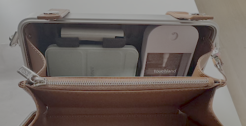
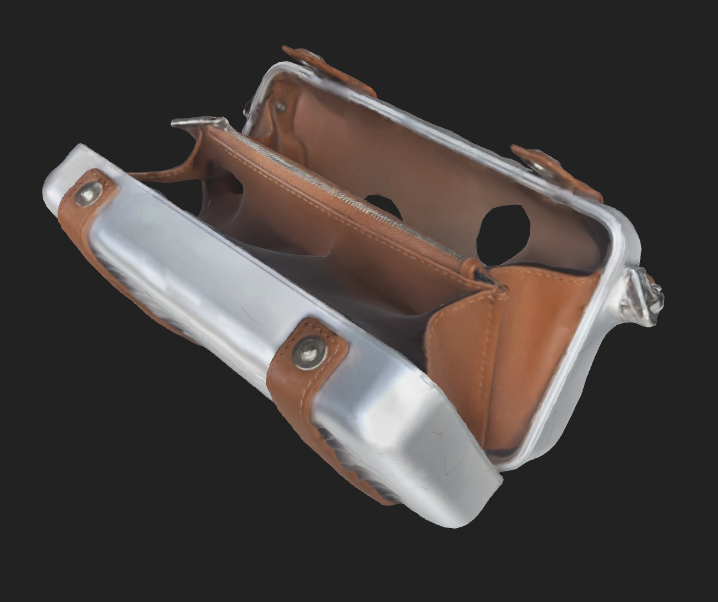
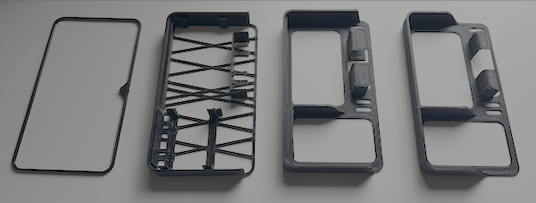

# purse-organizer

3D-printable organizer insert for a Rimowa crossbody bag. Fits either half.

## The problem

The purse fits nothing, and I have to tetris all my edc to close it

## The solution

Purpose-built organizer so I can take advantage of the Y axis for storage

## Methodology

### Low fidelity scans

Use the Apple's official [Reality Composer](https://apps.apple.com/us/app/reality-composer/id1462358802) to make a scan of the compartment (`scans/Untitled Object.usdz`).

I also scanned the wax perfume because it's not a common object with readily available dimensions (`scans/Untitled Object 3.usdz`).

### Iterate with codex

All of the fits were correct on the first try:
* outside frame test fit was snug. Even with my terrible scan, seems codex was able to figure out an approximate thickness of the aluminum + leather and subtract it from official dimensions
* I only gave codex the names of my edc objects, eg "touchland spray" and "anker 622 maggo". Codex found the correct dimensions and the prototypes had snug fits

Codex prefers adding and subtracting shapes, and the final product reflects that. I would have preferred more contouring and tapered edges (for example, on how the top compartment joins with the backplate), but I'm not sure the design/CAD term for this, so I couldn't achieve that effect.

Final result is more utilitarian.

## Closing

Model used: Astra-6 on Medium. This used ~250% of a $20 codex subscription's weekly quota. RIP my resets.
